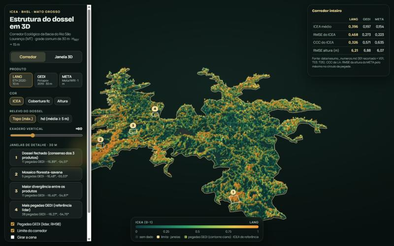
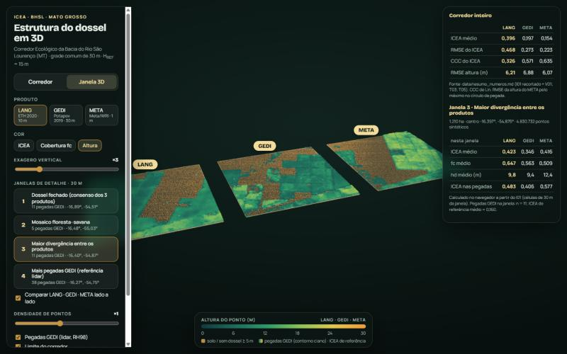

# ICEA 3D · Estrutura do dossel no Corredor do Rio São Lourenço (MT)

Visualização 3D interativa (Three.js) do **Índice de Cobertura pela Estrutura Arbórea (ICEA)** no Corredor Ecológico da Bacia do Rio São Lourenço (BHSL), Mato Grosso, Brasil. A página compara três mapas globais de altura do dossel (**LANG**, **GEDI/Potapov** e **META**) e mostra as pegadas do lidar espacial **GEDI** como referência.

**Página:** https://bonnexd01.github.io/icea-canopy-3d-bhsl/





> *English summary.* Interactive 3D viewer (Three.js) of a canopy-structure cover index (ICEA = fc × min(hd / 15 m, 1)) for the São Lourenço River Basin ecological corridor (Mato Grosso, Brazil), built from three global canopy height maps (Lang et al. 2023; Potapov et al. 2021; Tolan et al. 2024) on a common 30 m grid and checked against GEDI L2A/L2B footprints. The detail windows render a **synthetic** point cloud derived from each 30 m cell, not airborne lidar. Interface in Portuguese.

## O que a página mostra

| Elemento | Conteúdo |
|---|---|
| **Mapa** | imagem de satélite do planeta inteiro (Esri World Imagery, via MapLibre GL). A página abre no globo e voa até o corredor; "Ver o planeta" afasta de novo. |
| **Corredor 3D** | o corredor inteiro como relevo do dossel sobre o satélite (Three.js dentro do mapa), em blocos de 10 × 10 células (~270 m). A altura é o topo ou o hd, com exagero vertical que diminui sozinho ao aproximar; a cor é o ICEA, a cobertura fc ou a altura; a opacidade deixa ver o satélite por baixo. Cinza = sem dado (falhas do LANG). |
| **Pegadas GEDI** | círculos no mapa (raio real de 12,5 m ao aproximar), com a cor pelo ICEA de referência. |
| **Terreno real** | modelo digital de elevação (SRTM e outras fontes, AWS Terrain Tiles, formato Terrarium) com sombreamento e céu atmosférico. O corredor é assentado sobre o terreno: a altura de cada vértice é a cota do terreno (com exagero ajustável) mais o dossel exagerado. |
| **Modo apresentação** | tour guiado em 8 etapas, com voos de câmera e legendas que trazem os números do estudo: planeta → corredor sobre o relevo → ICEA pelo LANG, GEDI e META → janela de maior divergência → pegadas GEDI → concordância com o lidar. **Gravar vídeo** salva o tour inteiro em .webm (mapa, janela 3D e legendas), pronto para slides. |
| **Janela 3D** | ao clicar numa janela, o mapa voa até ela e a nuvem de pontos abre no canto, como na referência. São quatro recortes de 128 × 128 células (~3,5 km): dossel fechado (consenso dos 3 produtos), mosaico floresta–savana, maior divergência entre produtos e mais pegadas GEDI. As pegadas viram colunas com a altura RH98. O botão **Comparar** põe LANG, GEDI e META lado a lado, e **⤢** amplia o painel. A nuvem usa **Eye-Dome Lighting** (EDL), o sombreamento por profundidade dos visualizadores lidar como o Potree, que realça a forma das copas; o botão EDL liga e desliga. |

Ao passar o cursor, a página mostra os valores dos três produtos na célula ou na pegada. O botão **Salvar PNG** grava a vista atual.

### Como ler a nuvem de pontos (importante)

A nuvem da Janela 3D é **sintética**. Cada célula de 30 m recebe copas em número proporcional a `fc`, com altura sorteada entre `hd` e a altura de topo, em posições sorteadas com semente fixa. Ela mostra a estrutura que cada produto atribui ao dossel; **não é lidar**. Os únicos dados lidar na cena são as pegadas GEDI.

## Índice

```
ICEA     = fc × min(hd / H_REF, 1)                 H_REF = 15 m
ICEA_ref = cover_z1 × min(RH98 / H_REF, 1)         (pegadas GEDI L2A + L2B)
```

- `fc`: fração da célula de 30 m com dossel ≥ 5 m;
- `hd`: altura média dos pixels ≥ 5 m;
- topo: altura máxima na célula.

## Dados

| Arquivo (`data/`) | Conteúdo |
|---|---|
| `CESL_I01_icea_fc_hd_lang_gedi_meta_30m.tif` | 9 bandas: `icea_*` e `fc_*` (×1000), `hd_*` (dm) para LANG, GEDI e META; EPSG:4326, 0,00025° |
| `CESL_I02_altura_topo_lang_gedi_meta_30m.tif` | altura de topo (dm) dos três produtos |
| `CESL_I03_lang_fracao_valida_30m.tif` | fração da célula com dado no LANG (0–100; 255 = fora do corredor) |
| `CESL_T05_pegadas_gedi_produtos.csv` | pegadas GEDI 2019–2020 (sensibilidade ≥ 0,95) com RH98, `cover_z1` e os valores dos três produtos; `completa = 1` marca a amostra comum |
| `CESL_V01_limite_corredor.*` | limite do corredor (shapefile) |
| `resumo_numeros.md` | números-síntese usados no painel (ICEA médio, RMSE e CCC) |

Os dois TIF grandes (I01 e I02) estão no repositório via **Git LFS**.

Produtos de origem:
- LANG: ETH Global Canopy Height 2020, 10 m (Lang et al. 2023);
- GEDI: GLAD/UMD Global Forest Canopy Height 2019, 30 m (Potapov et al. 2021);
- META: Meta/WRI High Resolution Canopy Height, 1 m (Tolan et al. 2024);
- referência: GEDI L2A e L2B V002 (Dubayah et al. 2020).

O processamento no Google Earth Engine está em [`gee/corredor_sao_lourenco_indice_dossel.js`](gee/corredor_sao_lourenco_indice_dossel.js) (v1.3). O script lê assets do autor (`projects/ee-davidaranha/...`); para rodar em outra conta, troque esses caminhos pelos seus.

## Reconstruir a página

```bash
pip install -r requirements.txt
python scripts/exportar_visualizacao_3d.py      # lê data/ e web/, grava docs/index.html
```

O script:
1. agrega os rasters em blocos de 10 × 10 células;
2. escolhe as quatro janelas de detalhe;
3. codifica tudo em `uint8` comprimido (zlib + base64);
4. injeta os dados no modelo `web/visualizador_icea_3d.template.html`.

O navegador descompacta com `DecompressionStream`. O resultado é um HTML único, de ~2 MB, que também abre com duplo clique.

Para editar o visual, mexa no modelo em `web/` e rode o script de novo. Não edite `docs/index.html` à mão.

## Publicar no GitHub Pages

*Settings → Pages → Build and deployment → Deploy from a branch → `main` / `docs`*

## Estrutura

```
data/      rasters, pegadas e limite (TIF via Git LFS)
docs/      página publicada (index.html gerado) e imagens do README
gee/       script do Google Earth Engine
scripts/   exportação para a web (Python)
web/       modelo HTML/JS do visualizador (Three.js r160)
```

## Tecnologia

- MapLibre GL JS 4.7.1 com imagens Esri World Imagery;
- Three.js 0.160 (ES modules via jsDelivr) como camada 3D do mapa e na janela de detalhe, com OrbitControls;
- fontes Bricolage Grotesque e Manrope;
- nenhum bundler.

Visual inspirado em [linaq11/lidar-mangrove-canopy](https://github.com/linaq11/lidar-mangrove-canopy).

## Limitações

- Os três produtos usaram GEDI no treino ou na calibração; a referência não é totalmente independente.
- A posição da pegada tem erro de geolocalização de ~10 m.
- `H_REF = 15 m` é um valor de trabalho.
- O GEDI/Potapov é nativo em 30 m, então o fc dele é binário (0 ou 1).

## Citação e licença

Autor: David Albuquerque Aranha ([ORCID 0009-0005-1631-1676](https://orcid.org/0009-0005-1631-1676)). Ver [`CITATION.cff`](CITATION.cff).

- Código: licença MIT ([`LICENSE`](LICENSE)).
- Dados derivados em `data/` e `docs/`: CC BY 4.0. Os produtos de origem mantêm as licenças dos seus autores.

### Referências

- Dubayah R et al. 2020. The Global Ecosystem Dynamics Investigation: high-resolution laser ranging of the Earth's forests and topography. *Science of Remote Sensing* 1: 100002. https://doi.org/10.1016/j.srs.2020.100002
- Lang N et al. 2023. A high-resolution canopy height model of the Earth. *Nature Ecology & Evolution* 7: 1778–1789. https://doi.org/10.1038/s41559-023-02206-6
- Potapov P et al. 2021. Mapping global forest canopy height through integration of GEDI and Landsat data. *Remote Sensing of Environment* 253: 112165. https://doi.org/10.1016/j.rse.2020.112165
- Tolan J et al. 2024. Very high resolution canopy height maps from RGB imagery using self-supervised vision transformer and convolutional decoder trained on aerial lidar. *Remote Sensing of Environment* 300: 113888. https://doi.org/10.1016/j.rse.2023.113888
